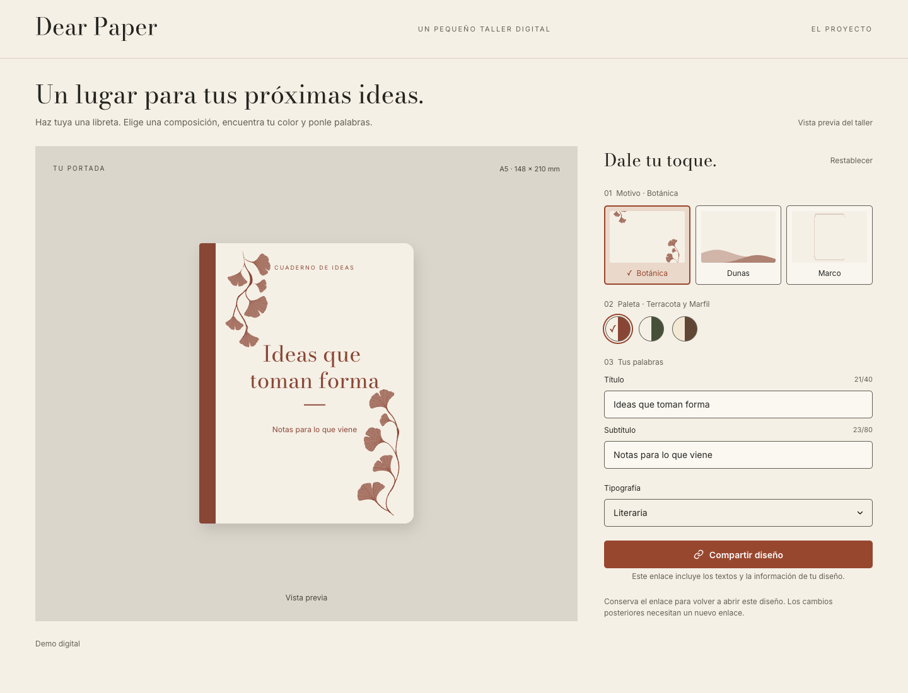

# 📓 Dear Paper

Developed by Gisela Rosibel Scarpin.

A small digital workshop for creating your own notebook cover. Choose a motif, find your colors, add your words, and share the result with a link.

The application interface is in Spanish. This is a digital demo; the preview does not represent a printed product.

## 📥 Clone and run the project locally

**Prerequisites:** Node.js 22.13 or later and pnpm 11.1.2 (the package manager declared in `package.json`). The Node.js requirement accommodates both Next.js and pnpm.

```sh
git clone https://github.com/giselars/dear-paper-app.git
cd dear-paper
pnpm install --frozen-lockfile
pnpm dev --hostname 127.0.0.1 --port 3100
```

Open [Dear Paper locally](http://127.0.0.1:3100).

To run a production build instead:

```sh
pnpm build
pnpm start --hostname 127.0.0.1 --port 3100
```

No environment variables or external services are required. Development compilation and production builds need network access to retrieve Bodoni Moda and Inter through `next/font/google`; the application then serves the fonts locally to visitors.

## 📸 Screenshot



## 🔧 Solution overview

- **Live customization:** three motifs—Botánica, Dunas, and Marco—six cover colors, a title, a subtitle, and light or dark text. Literaria, using Bodoni Moda, is the available title typeface; the subtitle uses Inter.
- **A5 cover preview:** text wraps and scales within a 148 × 210 coordinate space. The title supports up to 40 Unicode code points and the subtitle up to 80. Invalid drafts remain visible with feedback while the preview keeps the last valid design.
- **Responsive editing:** desktop and tablet layouts place the preview beside the controls. On mobile, a compact preview follows scrolling and can be expanded in a dialog.
- **Shareable snapshots:** sharing opens a preview before copying a link. Recipients see a read-only cover at `/shared`. If clipboard access fails, a selected field offers the link for manual copying. The URL includes the cover text, so it should not contain private information.
- **Clear feedback:** low-contrast combinations show a warning, reset restores the initial configuration, and loading or font failures have explicit states. A project dialog introduces the demo and can be reopened from the header.

Designs are encoded in URLs rather than stored in a database or browser storage. Reloading the editor without an incoming design restores defaults; later edits require a new shared link. Standalone SVG download is deferred.

## 🏗️ Proposed architecture

The implementation follows a feature-based frontend architecture with Next.js App Router. Routes and the root layout are Server Components; client components manage editing, loading states, and dialogs.

| Layer              | Responsibility                                                                                                                     |
| ------------------ | ---------------------------------------------------------------------------------------------------------------------------------- |
| App                | Compose routes, metadata, fonts, and the shared layout.                                                                            |
| Components         | Provide shared header, footer, and reusable form fields.                                                                           |
| Feature components | Render editor controls, cover previews, sharing, and project information.                                                          |
| Hooks              | Connect reducer state, font readiness, cover layout, and responsive interactions.                                                  |
| Domain             | Define the catalog, validate configuration, update state, lay out text, and encode or decode shared designs using pure TypeScript. |
| Browser adapters   | Load fonts, measure text, access the clipboard, and update browser history.                                                        |
| Styles             | Combine local Sass Modules with shared semantic tokens and global foundations.                                                     |

One validated `CoverConfiguration` drives the editor. Controls dispatch changes through `useCustomizer` and its reducer. A deterministic scene builder produces the cover layout, and `CoverArtwork` renders the same scene for the full, compact, expanded, and shared previews.

External URL data is validated before use. Browser APIs stay outside the domain layer. The current scope uses React state without a global state library, backend, API routes, or database.

## 📂 Project structure

```text
dear-paper/
├── public/assets/
│   ├── brand/                 # Wordmarks
│   ├── icons/                 # Interface icons
│   ├── licenses/              # Third-party asset notices
│   ├── motifs/                # Cover artwork
│   ├── screenshots/           # README images
│   └── thumbnails/            # Motif selector previews
├── src/
│   ├── app/
│   │   ├── shared/page.tsx    # Read-only shared design route
│   │   ├── layout.tsx         # Root layout, fonts, and metadata
│   │   └── page.tsx           # Editor route
│   ├── components/
│   │   ├── layout/            # Header and footer
│   │   └── ui/                # Shared UI components
│   ├── features/
│   │   ├── customizer/
│   │   │   ├── adapters/      # Browser integrations
│   │   │   ├── components/    # Controls, previews, and sharing
│   │   │   ├── domain/        # Configuration, reducer, scene, URL codec
│   │   │   └── hooks/         # Editor state and interactions
│   │   └── project/
│   │       └── components/    # Project information dialog
│   └── styles/                # Tokens and global styles
├── e2e/                       # Playwright browser tests
├── playwright.config.ts
├── vitest.config.mts
├── package.json
└── pnpm-lock.yaml
```

Unit and component tests live alongside the source files as `*.test.ts` and `*.test.tsx`.

## 💻 Technologies used

| Technology                       | Purpose                                                |
| -------------------------------- | ------------------------------------------------------ |
| Next.js 16.4.4 · App Router      | Routing, server rendering, metadata, and font delivery |
| React 19.3.0                     | UI composition, state, and interactive behavior        |
| TypeScript · strict mode         | Typed components and domain contracts                  |
| Sass Modules                     | Component styles and shared design tokens              |
| SVG                              | Scalable cover artwork and previews                    |
| Vitest · Testing Library · jsdom | Domain and component tests                             |
| Playwright · axe-core            | Chrome journeys and automated accessibility checks     |
| ESLint · Prettier                | Code quality and formatting                            |
| pnpm 11.1.2                      | Dependency management and project scripts              |

Third-party notices for the included Lucide icons and Bodoni Moda artwork are preserved in [public/assets/licenses](public/assets/licenses/).

## 🧪 Tests

Run the unit and component suite:

```sh
pnpm test
```

Tests cover configuration validation, reducer updates, text layout, shared-link encoding and decoding, browser sharing failures, input behavior, and startup states.

For end-to-end tests, have Google Chrome installed and start the application on port 3100 in another terminal, then run:

```sh
pnpm test:e2e
```

Playwright uses the installed Chrome through `channel: "chrome"`. The runner does not start a server or download a browser. Set `PLAYWRIGHT_BASE_URL` to target another address.

Browser journeys cover customization, text bounds, keyboard navigation, mobile previews, sharing and recipient views, invalid links, clipboard fallback, font failures, and project dialogs. They also include automated axe accessibility checks. Mobile keyboard behavior is simulated; actual device keyboards and browser zoom need manual verification.

Additional checks:

```sh
pnpm lint
pnpm exec tsc --noEmit
pnpm exec prettier --check .
pnpm build
```

To run a check against existing dependencies without pnpm triggering an automatic installation, prefix that command with `pnpm_config_verify_deps_before_run=false`.
